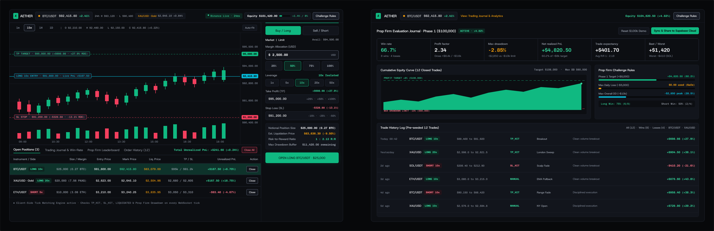
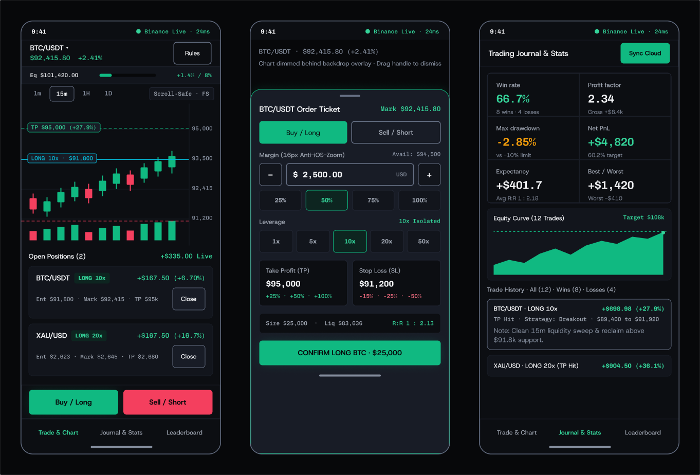

# AETHER Terminal

Paper trading terminal for crypto and gold with a $100,000 prop firm evaluation, live market data, and a trade journal.

Live URL: https://trading.iqbalfa.my.id

## Screenshots





## Features

- Live BTC/USDT, ETH/USDT, SOL/USDT, and XAU/USD candles and tickers from Binance WebSocket, with a simulated feed as fallback.
- Prop firm rules: $100,000 starting balance, 8% profit target, 10% maximum drawdown.
- Market and limit orders with isolated leverage from 1x to 50x, take profit, stop loss, and liquidation, shown as price lines on the chart.
- Trade journal with win rate, profit factor, max drawdown, expectancy, equity curve, and trade history.
- Responsive layout with a full desktop terminal and a mobile view that uses a bottom sheet order ticket and tab navigation.
- Optional Supabase sync for shareable read-only reports and a public leaderboard.

## Tech Stack

Next.js 16, React 19, TypeScript, Tailwind CSS 4, Zustand, Lightweight Charts, Supabase, Vitest.

## Getting Started

```bash
npm install
cp .env.example .env.local
npm run dev
```

Open http://localhost:3000.

The app runs without Supabase and saves progress in the browser. To enable cloud sync, fill in `.env.local` and run `supabase/schema.sql` in the Supabase SQL Editor.

## Environment Variables

| Variable | Description |
| --- | --- |
| `NEXT_PUBLIC_SUPABASE_URL` | Supabase project URL |
| `NEXT_PUBLIC_SUPABASE_ANON_KEY` | Supabase publishable key |
| `SUPABASE_SERVICE_ROLE_KEY` | Server-only key used by API routes |
| `NEXT_PUBLIC_SITE_URL` | Optional. Public URL used for link previews |

## Scripts

| Command | Description |
| --- | --- |
| `npm run dev` | Start the development server |
| `npm run build` | Create a production build |
| `npm start` | Run the production build |
| `npm test` | Run unit tests |
| `npm run lint` | Run ESLint |

## Deployment

Import the repository into Vercel, add the environment variables above, and deploy.
